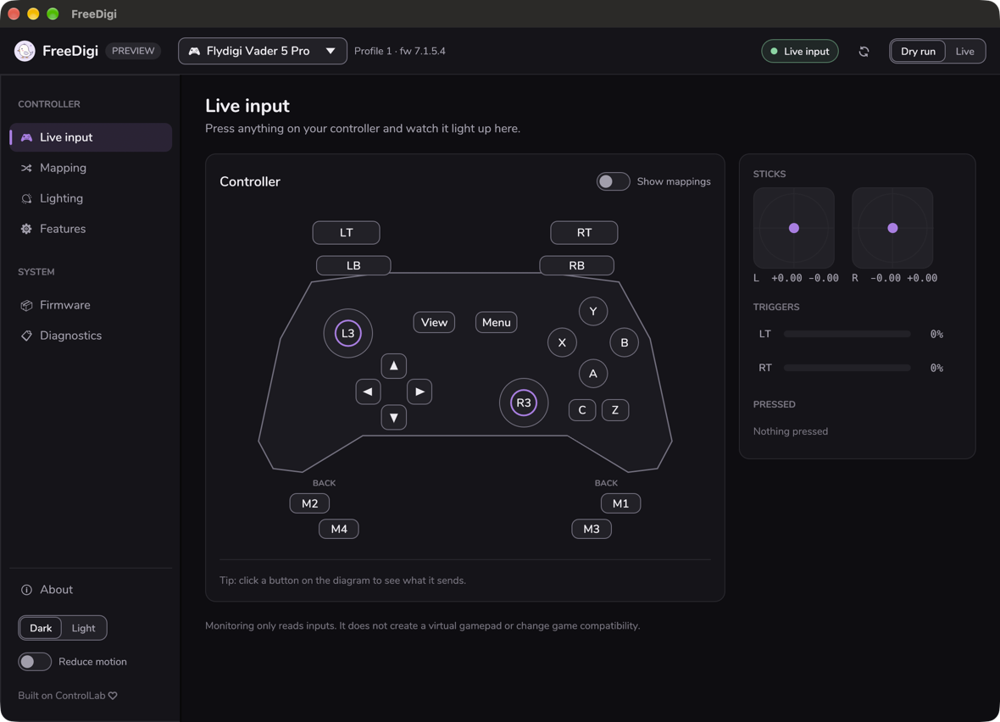

# FreeDigi

A desktop controller app for **Linux and macOS**, built with **Rust + egui** (Metal via wgpu on macOS, OpenGL on Linux).
Configure your Flydigi Vader 5 Pro, inspect live inputs, and see exactly what the app is doing.

**Based on [ControlLab](https://github.com/dracinn/ControlLab), the original Swift controller app by dracinn.** FreeDigi reuses its controller protocol implementation and tests. The original MIT copyright and license are preserved, and the app includes an About credit. See [NOTICE](NOTICE) and [LICENSE](LICENSE).



[See the visual mapping editor](docs/freedigi-native-mapping.png)

## Status

This is an early desktop preview. The Linux executable builds and the portable protocol and native state/safety tests pass. **The new Linux transport has not yet been tested against a physical controller.** The macOS transport adapts the original ControlLab IOKit session; a FreeDigi macOS build must be run and verified on a Mac.

- Automatic controller discovery and live input monitoring on a controller diagram, including extra face and back buttons.
- Settings are read in the background once a controller connects, so pages open with data; opening a page re-checks it and the view changes only if the controller reports something different.
- Visual single-button mapping editor; temporary apply or persistent save.
- Profile backups, conflict checks, verified readback and the existing bounded retry logic.
- Physical Turbo-button feature toggle and automatic stick-calibration toggle.
- Controller solid-color lighting, brightness and off.
- Installed firmware versions, diagnostics, copy/export report.
- Dry runs enabled at startup. Reads are live; setting writes are only planned until dry run is disabled.

**Not included in this preview:** firmware flashing, Bluetooth configuration, macro/combo/rapid-fire editors, dock lighting, press-to-map, and virtual gamepad output. Existing advanced profile bytes are preserved. This app does not change how games or macOS recognize the dongle, and does not remove Apple's virtual-HID entitlement restriction.

Windows has [minimal groundwork](docs/freedigi-windows.md) only; no Windows controller backend or release is available yet.

The original SwiftUI ControlLab app and the earlier Wails preview have been removed; the ControlLab protocol core, tests and CLI remain ([ControlLab documentation](CONTROLLAB.md)). FreeDigi is not yet feature-complete relative to the original app, whose UI is available upstream.

## Download and build

The `v0.1.0-preview` release is the older Wails build. The native egui interface is in `main`; native packages are produced by the FreeDigi workflows.

See [Releases](https://github.com/ruxxzebre/freedigi/releases) for available builds, and [native/README.md](native/README.md) for installation, dependencies and local builds.

```sh
git clone https://github.com/ruxxzebre/freedigi.git
cd freedigi
./native/scripts/build.sh
```

Linux builds run on a GitHub Ubuntu runner. macOS builds are manually triggered on the owner's self-hosted Mac; [runner setup](docs/freedigi-mac-runner.md).

## Architecture

```text
egui interface → Rust operation worker → Swift command service
                                                    ├─ Linux: hidraw
                                                    └─ macOS: IOKit
```

The protocol stays in Swift to preserve ControlLab's tested behavior. One Rust worker owns device selection, automatic discovery/read freshness, dry-run state, cached snapshots and process lifetimes. Pages share this state, with one Refresh button for recovery. It pauses the input stream during configuration operations and resumes it afterward. The helper exits after each operation; monitoring keeps one helper alive. No background daemon or paid dependency is needed.

The Chaiky gull is vendored under `native/vendor/chaiky-theme` and is the only
shared component compiled in (Cargo feature `mascot`); FreeDigi's own controls and
palette live in `native/src/ui`. New upstream components are not copied automatically. See the
[native theme update instructions](native/README.md#shared-theme-selectively-vendored).
The app icon source is `native/assets/freedigi.svg`.

Use `nix develop` for the pinned Rust tools and Linux graphics libraries.
`flake.lock` uses the same nixpkgs revision as Chaiky/Core; `native/Cargo.lock`
pins crates. Swift 6 remains an external toolchain (6.0.3 on Linux, Xcode on Mac).

[Validation and known limits](docs/freedigi-validation.md) documents what has actually been tested.

FreeDigi is independent community software, not affiliated with Flydigi. Controller names and artwork identify the supported hardware.
