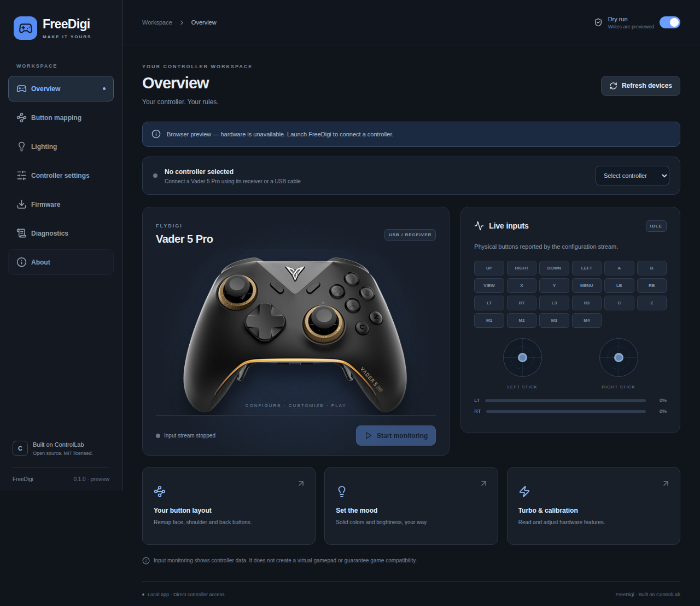

# FreeDigi

A desktop controller app for **Linux and macOS**, built with Wails and React.
Configure your Flydigi Vader 5 Pro, inspect live inputs, and see exactly what the app is doing.

**Based on [ControlLab](https://github.com/dracinn/ControlLab), the original Swift controller app by dracinn.** FreeDigi reuses its controller protocol implementation and tests. The original MIT copyright and license are preserved, and the app includes an About credit. See [NOTICE](NOTICE) and [LICENSE](LICENSE).



## Status

This is an early desktop preview. The Linux executable builds and the portable protocol, service-boundary and browser interaction tests pass. **The new Linux transport has not yet been tested against a physical controller.** The macOS transport adapts the original ControlLab IOKit session; a FreeDigi macOS build must be run and verified on a Mac.

- Live physical input monitor, including the extra face and back buttons.
- Read active profile; edit single-button mappings; temporary apply or persistent save.
- Profile backups, conflict checks, verified readback and the existing bounded retry logic.
- Physical Turbo-button feature toggle and automatic stick-calibration toggle.
- Controller solid-color lighting, brightness and off.
- Installed firmware versions, diagnostics, copy/export report.
- Dry runs enabled at startup. Reads are live; setting writes are only planned until dry run is disabled.

**Not included in this preview:** firmware flashing, Bluetooth configuration, macro/combo/rapid-fire editors, dock lighting, press-to-map, and virtual gamepad output. Existing advanced profile bytes are preserved. This app does not change how games or macOS recognize the dongle, and does not remove Apple's virtual-HID entitlement restriction.

The original Swift app and its existing features remain available in this repository; see [the ControlLab documentation](CONTROLLAB.md). FreeDigi is not yet feature-complete relative to it.

## Download and build

See [Releases](https://github.com/ruxxzebre/freedigi/releases) for available builds, and [desktop/README.md](desktop/README.md) for installation, dependencies and local builds.

```sh
git clone https://github.com/ruxxzebre/freedigi.git
cd freedigi
./desktop/scripts/build.sh
```

Linux builds run on a GitHub Ubuntu runner. macOS builds are manually triggered on the owner's self-hosted Mac; [runner setup](docs/freedigi-mac-runner.md).

## Architecture

```text
React interface → Wails / Go operation coordinator → Swift command service
                                                    ├─ Linux: hidraw
                                                    └─ macOS: IOKit
```

The protocol stays in Swift to preserve ControlLab's tested behavior. The Go layer owns device selection, dry-run state, cached snapshots and process lifetimes. It pauses the input stream during configuration operations and resumes it afterward. The helper exits after each operation; monitoring keeps one helper alive. No background daemon or paid dependency is needed.

[Validation and known limits](docs/freedigi-validation.md) documents what has actually been tested.

FreeDigi is independent community software, not affiliated with Flydigi. Controller names and artwork identify the supported hardware.
